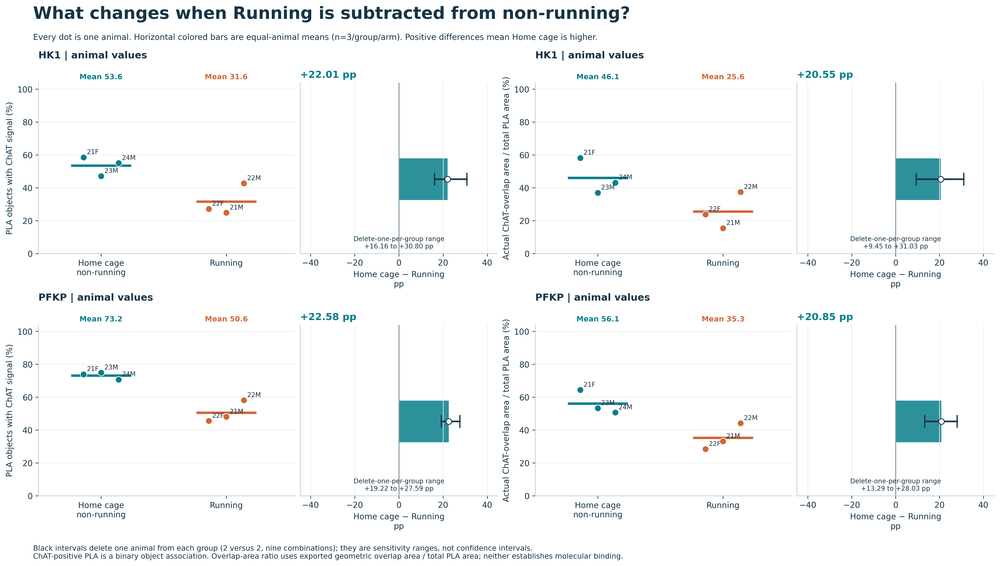
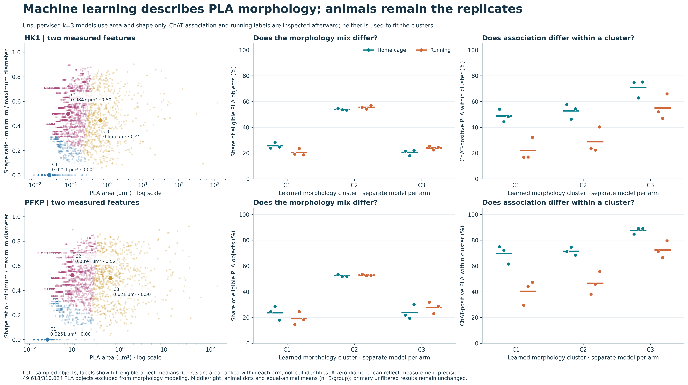
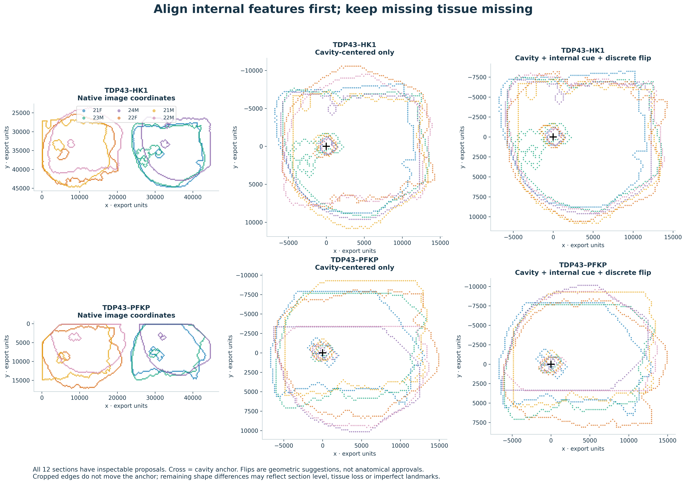

# PLA–ChAT results: a visual guide

This page presents the key results without a notebook viewer. Each image links to its full-resolution PNG. The [interactive app](../README.md#open-the-interactive-app) adds rotation, zoom, filters and review-table downloads: download the ZIP, unzip it and open `outputs/spatial_handoff/app/index.html` in your web browser. See [viewing help](quickstart.md) if needed.

**The experiment:** three Home-cage and three Running animals, each with separate tissue sections for the HK1 and PFKP PLA arms. HALO exported 3,010,776 detections across twelve retained sections. The main question is whether PLA association with the ChAT marker differs between conditions. Each animal receives equal weight; millions of detections do not replace biological replication.

[Condition comparison](#1-running-versus-home-cage) · [Machine learning](#2-what-the-morphology-analysis-adds) · [Spatial layers](#3-see-the-sections-and-the-proposed-alignment) · [Next actions](#what-to-check-next) · [All figures](../outputs/spatial_handoff/figures/)

## 1. Running versus Home cage

**The observed ChAT-positive PLA fraction is higher in Home-cage animals in both arms.** For each animal, divide the count of ChAT-positive PLA by all PLA detections and multiply by 100. Average the three animal percentages within each condition, then subtract Running from Home cage.

| PLA arm | Home-cage mean | Running mean | Home − Running |
|---|---:|---:|---:|
| TDP43–HK1 | 53.59% | 31.58% | **+22.01 percentage points** |
| TDP43–PFKP | 73.20% | 50.62% | **+22.58 percentage points** |

Each dot is one animal. The intervals show what happens when one animal is omitted from each group; they are **sensitivity ranges, not confidence intervals**. The right-hand panels use a different measurement: summed overlap area divided by summed PLA area. Neither outcome measures tissue coverage or neuron counts.

**Is it normalized?** The primary fraction is normalized by PLA count, and group averages weight animals equally. It is **not** corrected for tissue area, ChAT availability, acquisition or segmentation differences. Applying a common PLA size distribution leaves gaps of **+23.47 points (HK1)** and **+24.07 points (PFKP)**. Size mixture alone therefore does not explain the observed difference under this check.

**Subtracting the other way:** Running − Home gives **−22.01** and **−22.58 points**. It is the same comparison with its sign reversed, not independent evidence. The app lets you switch directions.

| Follow-up question | Supporting figure |
|---|---|
| What is divided by what? | [Normalization and both directions](../outputs/spatial_handoff/figures/17_normalization_both_directions.png) |
| Does one mouse explain the direction? | [All cross-animal and delete-one-per-group checks](../outputs/spatial_handoff/figures/14_condition_robustness.png) |
| Does PLA size explain the difference? | [Common-size standardization](../outputs/spatial_handoff/figures/15_condition_size_standardization.png) · [Size-filter sensitivity](../outputs/spatial_handoff/figures/10_size_and_filter_sensitivity.png) |
| Is the condition gap specific to one PLA arm? | [Within-animal arm comparison](../outputs/spatial_handoff/figures/18_within_animal_arm_comparison.png) |

## 2. What the morphology analysis adds

The exploratory model groups PLA detections by **area and diameter ratio**, separately for each arm. It balances animals during fitting and does not use Running status or ChAT association to learn the groups. Association is compared afterward. These are measurement patterns, not validated cell types.

Read left to right: measured size and shape → how common each group is in each animal → ChAT association within each group. The scatter is a display sample; summaries use all eligible detections. Comparing group abundance and within-group association answers different questions, so their differences can have opposite signs.

Giving animals a common learned morphology mixture leaves Home − Running association gaps of **+22.89 points (HK1)** and **+23.30 points (PFKP)**. The simple size-and-shape mixture does not remove the observed gap. This does not distinguish a biological change from marker, sampling or acquisition differences.

**A concrete QC priority:** 49,618 of 310,024 PLA detections (**16.0%**) have unusable diameter ratios and are excluded from shape modeling. They remain in the primary comparison. An area-only model retains all PLA and gives similar differences. Many objects in the smallest eligible group also have a zero reported minimum diameter, so measurement precision and segmentation need review before interpreting their shape.

The app's **Machine learning** section provides two separate downloads: **72 eligible-object review targets** and **72 excluded-morphology QC targets** across both arms. Each includes source-file, job/object identifiers and native-coordinate windows. These deliberately selected examples support microscopy review; they are not prevalence estimates.

| Follow-up question | Supporting figure |
|---|---|
| Are the patterns stable when an animal or model choice changes? | [Omitted-animal stability and model sensitivity](../outputs/spatial_handoff/figures/22_morphology_stability.png) |
| Where are the groups and excluded measurements located? | [HK1 native maps](../outputs/spatial_handoff/figures/23_morphology_native_hk1.png) · [PFKP native maps](../outputs/spatial_handoff/figures/23_morphology_native_pfkp.png) |

Stability measures agreement between fitted partitions, not prediction accuracy or biological validation. The weakest omitted-animal stability is the 21M/PFKP section, making it a useful section to inspect.

## 3. See the sections and the proposed alignment

The maps reconstruct detections from their bounding-box midpoints. **They are not original microscope photographs.** Proposed alignment uses internal cavity anchors and discrete flips to compare sections despite incomplete outer tissue boundaries.

**0/12 sections have anatomical approval.** These overlays support geometry review; they do not yet justify pooled anatomical group maps or pixelwise condition subtraction. Missing tissue stays missing. Source microscopy, calibration, section levels and ROI masks are needed to validate correspondence.

For interactive exploration, open the downloaded app → **Explore sections**:

- **3D measurements:** rotate and zoom a section; change the measurement. Height encodes signal, not tissue depth.
- **Channel overlay:** toggle PLA and ChAT, change opacity and inspect ChAT-positive or negative PLA.
- **Overlapping layers:** overlay all sections or step through individual animals; compare native positions with feature-aligned proposals. The exploded stack uses a display order, not measured anatomical depth. Keep the two arms separate.

| Static view available on GitHub | HK1 | PFKP |
|---|---|---|
| PLA/ChAT reconstructed overlays | [Open](../outputs/spatial_handoff/figures/02_native_overlay_hk1.png) | [Open](../outputs/spatial_handoff/figures/02_native_overlay_pfkp.png) |
| ChAT-positive PLA fraction maps | [Open](../outputs/spatial_handoff/figures/06_fraction_atlas_hk1.png) | [Open](../outputs/spatial_handoff/figures/06_fraction_atlas_pfkp.png) |
| Proposed cavity traces for every section | [Open](../outputs/spatial_handoff/figures/20_proposed_cavity_traces_hk1.png) | [Open](../outputs/spatial_handoff/figures/20_proposed_cavity_traces_pfkp.png) |
| 3D measurement companion figure | [Open](../outputs/spatial_handoff/figures/08_surface_companion_hk1.png) | [Open](../outputs/spatial_handoff/figures/08_surface_companion_pfkp.png) |

For a complementary spatial measurement, see the [nearest-ChAT midpoint curves](../outputs/spatial_handoff/figures/11_nearest_chat_distance.png). Distances remain in uncalibrated export units and are not molecular distances or evidence of enrichment.

## What to check next

| Priority | Evidence available now | What to request or do |
|---|---|---|
| Review imaging and detection | [Condition-aligned source-image layout](../outputs/spatial_handoff/figures/16_condition_image_layout.png) | Obtain original channels and acquisition/composite provenance; compare illumination, background and HALO thresholds in blinded equivalent fields. Offsets added after detection cannot themselves change association. |
| Review questionable morphology | Native exclusion maps and the app's two review-target downloads | Inspect source crops with segmentation outlines, especially zero-diameter, very small and large detections; document any correction rule consistently across animals. |
| Validate anatomy before spatial subtraction | Proposed cavity traces, flips and layer overlays | Confirm landmarks, orientation, common scale and tissue support for all sections. Approvals require scientist review. |
| Test the biological explanation | The gap persists across several descriptive checks | Add negative PLA controls, matched section levels and more animals. These observations alone do not establish binding, metabolic flux or a causal running effect. |

## Full analysis and downloadable files

All values above describe the saved October 19, 2026 analysis. The [main notebook](https://github.com/adamwbrew/Bio_Data_Analysis/raw/refs/heads/main/PLA_ChAT_scientific_analysis.ipynb?download=1) and [full audit notebook](https://github.com/adamwbrew/Bio_Data_Analysis/raw/refs/heads/main/PLA_ChAT_spatial_handoff_analysis.ipynb?download=1) retain the code, methods and executed outputs. The full audit is too large for GitHub's preview; download it and read it in VS Code/JupyterLab if you need every detail. No rerun is needed for reading saved results.

[All PNG/SVG figures](../outputs/spatial_handoff/figures/) · [Analysis tables and review coordinates](../outputs/spatial_handoff/tables/) · [Execution validation](../outputs/spatial_handoff/validation.json) · [Viewing and recomputation help](quickstart.md) · [Back to README](../README.md)
